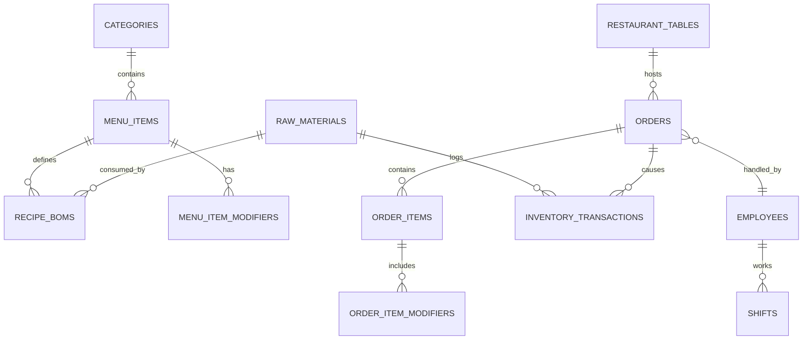

# LƯỢC ĐỒ VÀ KẾ HOẠCH CHUYỂN ĐỔI DATABASE THẬT (POSTGRESQL / SUPABASE)
> **Dự án**: Smart Restaurant POS System (Vibe Taste POS)  
> **Phiên bản lược đồ**: v1.0.0 (Production-Ready)  
> **Mục tiêu**: Chuyển đổi toàn bộ mock state (`mockData.ts`) sang cơ sở dữ liệu quan hệ PostgreSQL trên nền tảng Supabase, có đầy đủ Foreign Keys, Constraints, ACID Trigger trừ kho BOM tự động, và Row Level Security (RLS).

---

## 1. Kiến Trúc Lược Đồ (Database Architecture Overview)



---

## 2. SQL DDL Migration Script (Chạy trực tiếp trên Supabase SQL Editor)

```sql
-- ============================================================================
-- PHẦN 1: EXTENSIONS & ENUMS
-- ============================================================================
CREATE EXTENSION IF NOT EXISTS "uuid-ossp";

-- Trạng thái bàn
CREATE TYPE table_status_enum AS ENUM ('available', 'occupied', 'billing', 'reserved');

-- Trạng thái đơn hàng
CREATE TYPE order_status_enum AS ENUM ('pending', 'cooking', 'ready', 'served', 'completed', 'cancelled');

-- Trạng thái từng món
CREATE TYPE item_status_enum AS ENUM ('pending', 'cooking', 'ready', 'served', 'cancelled');

-- Trạm chế biến
CREATE TYPE station_type_enum AS ENUM ('kitchen', 'bar');

-- Trạng thái thanh toán
CREATE TYPE payment_status_enum AS ENUM ('unpaid', 'paid', 'refunded');

-- Phương thức thanh toán
CREATE TYPE payment_method_enum AS ENUM ('cash', 'transfer_qr', 'credit_card', 'momo');

-- Loại biến động kho
CREATE TYPE transaction_type_enum AS ENUM ('in', 'out', 'adjustment', 'waste');

-- Vai trò nhân viên
CREATE TYPE employee_role_enum AS ENUM ('admin', 'manager', 'cashier', 'chef', 'barista', 'waiter');

-- ============================================================================
-- PHẦN 2: THIẾT LẬP BẢNG DANH MỤC VÀ MENU
-- ============================================================================

-- Bảng Danh mục món
CREATE TABLE categories (
    id UUID PRIMARY KEY DEFAULT uuid_generate_v4(),
    name VARCHAR(100) NOT NULL,
    slug VARCHAR(100) UNIQUE NOT NULL,
    icon VARCHAR(50) DEFAULT 'Utensils',
    display_order INT DEFAULT 0,
    created_at TIMESTAMPTZ DEFAULT NOW(),
    updated_at TIMESTAMPTZ DEFAULT NOW()
);

-- Bảng Món ăn / Đồ uống
CREATE TABLE menu_items (
    id UUID PRIMARY KEY DEFAULT uuid_generate_v4(),
    category_id UUID NOT NULL REFERENCES categories(id) ON DELETE RESTRICT,
    name VARCHAR(255) NOT NULL,
    description TEXT,
    price NUMERIC(15, 2) NOT NULL CHECK (price >= 0),
    image_url TEXT,
    station station_type_enum NOT NULL DEFAULT 'kitchen',
    is_available BOOLEAN DEFAULT TRUE,
    preparation_time_minutes INT DEFAULT 15,
    created_at TIMESTAMPTZ DEFAULT NOW(),
    updated_at TIMESTAMPTZ DEFAULT NOW()
);

-- Nhóm Topping / Tùy biến (Modifiers)
CREATE TABLE menu_item_modifiers (
    id UUID PRIMARY KEY DEFAULT uuid_generate_v4(),
    menu_item_id UUID NOT NULL REFERENCES menu_items(id) ON DELETE CASCADE,
    group_name VARCHAR(100) NOT NULL, -- e.g., 'Mức đường', 'Topping'
    name VARCHAR(100) NOT NULL,       -- e.g., 'Trân châu đen', '50% Đường'
    price_adjustment NUMERIC(15, 2) DEFAULT 0,
    is_required BOOLEAN DEFAULT FALSE,
    created_at TIMESTAMPTZ DEFAULT NOW()
);

-- ============================================================================
-- PHẦN 3: SƠ ĐỒ BÀN & QUẢN TRỊ PHÒNG
-- ============================================================================

CREATE TABLE restaurant_tables (
    id UUID PRIMARY KEY DEFAULT uuid_generate_v4(),
    table_number VARCHAR(50) UNIQUE NOT NULL,
    capacity INT NOT NULL DEFAULT 4,
    zone VARCHAR(100) DEFAULT 'Main Dining Room',
    status table_status_enum NOT NULL DEFAULT 'available',
    current_order_id UUID,
    created_at TIMESTAMPTZ DEFAULT NOW(),
    updated_at TIMESTAMPTZ DEFAULT NOW()
);

-- ============================================================================
-- PHẦN 4: ĐƠN HÀNG VÀ CHI TIẾT ĐƠN HÀNG (FOH / KDS / CASHIER)
-- ============================================================================

CREATE TABLE orders (
    id UUID PRIMARY KEY DEFAULT uuid_generate_v4(),
    order_code VARCHAR(50) UNIQUE NOT NULL, -- Mã ngắn hiển thị (e.g., ORD-20261013-001)
    table_id UUID REFERENCES restaurant_tables(id) ON DELETE SET NULL,
    table_number VARCHAR(50) NOT NULL,
    order_status order_status_enum NOT NULL DEFAULT 'pending',
    payment_status payment_status_enum NOT NULL DEFAULT 'unpaid',
    payment_method payment_method_enum,
    subtotal NUMERIC(15, 2) NOT NULL DEFAULT 0,
    discount_amount NUMERIC(15, 2) NOT NULL DEFAULT 0,
    tax_amount NUMERIC(15, 2) NOT NULL DEFAULT 0,
    total_amount NUMERIC(15, 2) NOT NULL DEFAULT 0,
    created_by UUID, -- REFERENCES employees(id)
    created_at TIMESTAMPTZ DEFAULT NOW(),
    updated_at TIMESTAMPTZ DEFAULT NOW()
);

CREATE TABLE order_items (
    id UUID PRIMARY KEY DEFAULT uuid_generate_v4(),
    order_id UUID NOT NULL REFERENCES orders(id) ON DELETE CASCADE,
    menu_item_id UUID NOT NULL REFERENCES menu_items(id) ON DELETE RESTRICT,
    menu_item_name VARCHAR(255) NOT NULL,
    quantity INT NOT NULL CHECK (quantity > 0),
    price NUMERIC(15, 2) NOT NULL,
    station station_type_enum NOT NULL,
    item_status item_status_enum NOT NULL DEFAULT 'pending',
    notes TEXT,
    created_at TIMESTAMPTZ DEFAULT NOW(),
    updated_at TIMESTAMPTZ DEFAULT NOW()
);

CREATE TABLE order_item_modifiers (
    id UUID PRIMARY KEY DEFAULT uuid_generate_v4(),
    order_item_id UUID NOT NULL REFERENCES order_items(id) ON DELETE CASCADE,
    modifier_id UUID REFERENCES menu_item_modifiers(id),
    name VARCHAR(100) NOT NULL,
    price_adjustment NUMERIC(15, 2) DEFAULT 0
);

-- ============================================================================
-- PHẦN 5: ERP KHO & ĐỊNH MỨC NGUYÊN LIỆU (RECIPE BOM)
-- ============================================================================

CREATE TABLE raw_materials (
    id UUID PRIMARY KEY DEFAULT uuid_generate_v4(),
    code VARCHAR(50) UNIQUE NOT NULL,
    name VARCHAR(255) NOT NULL,
    category VARCHAR(100) NOT NULL,
    current_stock NUMERIC(15, 3) NOT NULL DEFAULT 0,
    recipe_unit VARCHAR(50) NOT NULL,       -- e.g., 'g', 'ml', 'shot'
    cost_per_unit NUMERIC(15, 2) NOT NULL,
    min_stock_level NUMERIC(15, 3) NOT NULL,
    created_at TIMESTAMPTZ DEFAULT NOW(),
    updated_at TIMESTAMPTZ DEFAULT NOW()
);

-- Định mức Bill of Materials cho từng món ăn
CREATE TABLE recipe_boms (
    id UUID PRIMARY KEY DEFAULT uuid_generate_v4(),
    menu_item_id UUID NOT NULL REFERENCES menu_items(id) ON DELETE CASCADE,
    raw_material_id UUID NOT NULL REFERENCES raw_materials(id) ON DELETE RESTRICT,
    quantity_required NUMERIC(15, 3) NOT NULL CHECK (quantity_required > 0),
    created_at TIMESTAMPTZ DEFAULT NOW(),
    UNIQUE(menu_item_id, raw_material_id)
);

-- Lịch sử biến động kho (Audit Log & Tracking)
CREATE TABLE inventory_transactions (
    id UUID PRIMARY KEY DEFAULT uuid_generate_v4(),
    raw_material_id UUID NOT NULL REFERENCES raw_materials(id) ON DELETE RESTRICT,
    type transaction_type_enum NOT NULL,
    quantity NUMERIC(15, 3) NOT NULL,
    previous_stock NUMERIC(15, 3) NOT NULL,
    remaining_stock NUMERIC(15, 3) NOT NULL,
    cost_per_unit NUMERIC(15, 2) NOT NULL,
    reason TEXT NOT NULL,
    reference_id UUID, -- Liên kết tới Order ID hoặc Purchase Order ID
    created_by UUID,
    created_at TIMESTAMPTZ DEFAULT NOW()
);

-- ============================================================================
-- PHẦN 6: NHÂN SỰ (HR RBAC) & CẤU HÌNH HỆ THỐNG
-- ============================================================================

CREATE TABLE employees (
    id UUID PRIMARY KEY DEFAULT uuid_generate_v4(),
    code VARCHAR(50) UNIQUE NOT NULL,
    name VARCHAR(255) NOT NULL,
    phone VARCHAR(20),
    role employee_role_enum NOT NULL DEFAULT 'waiter',
    pin_code VARCHAR(6), -- Mã PIN 4-6 số mở khóa ca làm
    is_active BOOLEAN DEFAULT TRUE,
    created_at TIMESTAMPTZ DEFAULT NOW()
);

CREATE TABLE store_settings (
    id UUID PRIMARY KEY DEFAULT uuid_generate_v4(),
    store_name VARCHAR(255) NOT NULL DEFAULT 'Vibe Taste Gourmet',
    phone VARCHAR(50),
    address TEXT,
    tax_rate NUMERIC(5, 2) DEFAULT 8.0,
    service_charge_rate NUMERIC(5, 2) DEFAULT 0.0,
    bank_bin VARCHAR(20) DEFAULT '970422',
    bank_account_number VARCHAR(50) DEFAULT '1903678912345',
    bank_account_name VARCHAR(255) DEFAULT 'VIBE TASTE GOURMET POS',
    updated_at TIMESTAMPTZ DEFAULT NOW()
);
```

---

## 3. ACID Trigger Tự Động Trừ Kho (BOM Auto-Deduct on Payment)

> Khi trạng thái thanh toán của bảng `orders` chuyển thành `paid`, trigger dưới đây sẽ tự động chạy trong **1 transaction duy nhất (ACID)**:
> 1. Duyệt tất cả các món trong `order_items`.
> 2. Quét công thức `recipe_boms` tương ứng của từng món.
> 3. Trừ `current_stock` trong `raw_materials`.
> 4. Ghi lại bản ghi biến động vào `inventory_transactions`.

```sql
CREATE OR REPLACE FUNCTION fn_handle_order_payment_and_deduct_stock()
RETURNS TRIGGER AS $$
DECLARE
    v_item RECORD;
    v_bom RECORD;
    v_deduct_qty NUMERIC(15, 3);
    v_prev_stock NUMERIC(15, 3);
    v_new_stock NUMERIC(15, 3);
BEGIN
    -- Chỉ kích hoạt khi payment_status chuyển từ unpaid sang paid
    IF (OLD.payment_status = 'unpaid' AND NEW.payment_status = 'paid') THEN
        
        -- Giải phóng trạng thái bàn về available nếu bàn đang dùng
        IF NEW.table_id IS NOT NULL THEN
            UPDATE restaurant_tables
            SET status = 'available',
                current_order_id = NULL,
                updated_at = NOW()
            WHERE id = NEW.table_id;
        END IF;

        -- Duyệt qua từng order_item
        FOR v_item IN 
            SELECT menu_item_id, menu_item_name, quantity 
            FROM order_items 
            WHERE order_id = NEW.id AND item_status != 'cancelled'
        LOOP
            -- Duyệt định mức nguyên vật liệu của món
            FOR v_bom IN 
                SELECT raw_material_id, quantity_required 
                FROM recipe_boms 
                WHERE menu_item_id = v_item.menu_item_id
            LOOP
                v_deduct_qty := v_bom.quantity_required * v_item.quantity;

                -- Lấy số tồn kho hiện tại và khóa dòng (FOR UPDATE) để ngăn race condition
                SELECT current_stock INTO v_prev_stock 
                FROM raw_materials 
                WHERE id = v_bom.raw_material_id 
                FOR UPDATE;

                v_new_stock := v_prev_stock - v_deduct_qty;

                -- Cập nhật kho
                UPDATE raw_materials
                SET current_stock = v_new_stock,
                    updated_at = NOW()
                WHERE id = v_bom.raw_material_id;

                -- Ghi nhận lịch sử biến động kho
                INSERT INTO inventory_transactions (
                    raw_material_id,
                    type,
                    quantity,
                    previous_stock,
                    remaining_stock,
                    cost_per_unit,
                    reason,
                    reference_id
                ) VALUES (
                    v_bom.raw_material_id,
                    'out',
                    v_deduct_qty,
                    v_prev_stock,
                    v_new_stock,
                    0,
                    'Tự động trừ kho theo định mức BOM cho ' || v_item.menu_item_name,
                    NEW.id
                );
            END LOOP;
        END LOOP;
    END IF;

    RETURN NEW;
END;
$$ LANGUAGE plpgsql;

-- Gắn Trigger vào bảng orders
DROP TRIGGER IF EXISTS trg_order_payment_deduct_stock ON orders;
CREATE TRIGGER trg_order_payment_deduct_stock
AFTER UPDATE OF payment_status ON orders
FOR EACH ROW
EXECUTE FUNCTION fn_handle_order_payment_and_deduct_stock();
```

---

## 4. Kích Hoạt Realtime Trên Supabase (Realtime Publications)

Để thay thế `BroadcastChannel` bằng Supabase WebSocket khi lên Cloud:

```sql
-- Đưa các bảng cần lắng nghe liên thông vào publication supabase_realtime
ALTER PUBLICATION supabase_realtime ADD TABLE orders;
ALTER PUBLICATION supabase_realtime ADD TABLE order_items;
ALTER PUBLICATION supabase_realtime ADD TABLE restaurant_tables;
ALTER PUBLICATION supabase_realtime ADD TABLE raw_materials;
ALTER PUBLICATION supabase_realtime ADD TABLE inventory_transactions;
```

---

## 5. Row Level Security (RLS) & Phân Quyền

```sql
-- Kích hoạt RLS
ALTER TABLE orders ENABLE ROW LEVEL SECURITY;
ALTER TABLE order_items ENABLE ROW LEVEL SECURITY;
ALTER TABLE raw_materials ENABLE ROW LEVEL SECURITY;
ALTER TABLE employees ENABLE ROW LEVEL SECURITY;

-- Policy mẫu: Tất cả nhân viên đã xác thực được xem orders
CREATE POLICY "Authenticated staff can view orders"
ON orders FOR SELECT
TO authenticated
USING (true);

-- Policy mẫu: Waiter / Cashier được tạo đơn hàng mới
CREATE POLICY "Staff can insert orders"
ON orders FOR INSERT
TO authenticated
WITH CHECK (true);

-- Policy mẫu: Chỉ Admin / Manager mới được xem và cập nhật bảng nhân sự
CREATE POLICY "Only admin can manage employees"
ON employees FOR ALL
TO authenticated
USING (
  EXISTS (
    SELECT 1 FROM employees e 
    WHERE e.id = auth.uid() AND e.role IN ('admin', 'manager')
  )
);
```

---

## 6. Lộ Trình Triển Khai (Deployment Checklist)

1. **Bước 1**: Tạo project Supabase mới tại https://supabase.com.
2. **Bước 2**: Chạy toàn bộ script SQL từ mục 2, 3, 4, 5 trên `Supabase SQL Editor`.
3. **Bước 3**: Import seed data ban đầu từ `initialMenuItems`, `initialCategories`, `initialRawMaterials` bằng các câu lệnh `INSERT`.
4. **Bước 4**: Cài đặt `@supabase/supabase-js` trong Next.js:
   ```bash
   npm install @supabase/supabase-js
   ```
5. **Bước 5**: Thay thế adapter `realtimeEngine.ts` và `orderService.ts` trỏ tới `@supabase/supabase-js` client sử dụng channel `postgres_changes`.
